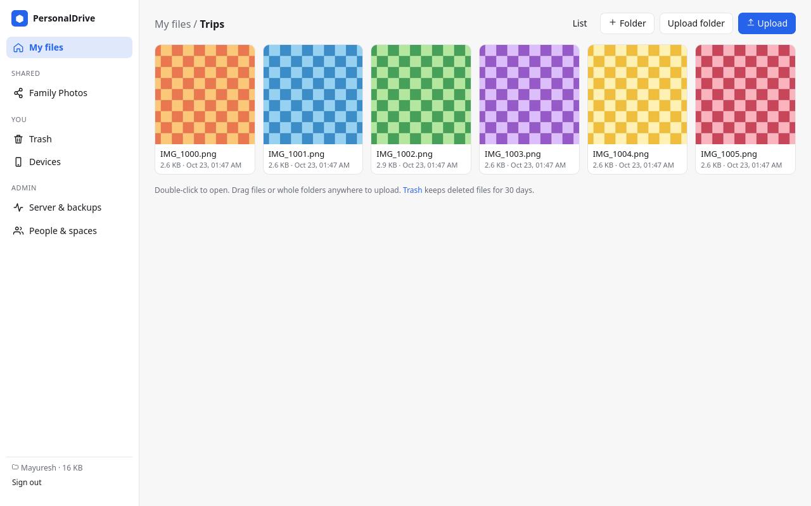
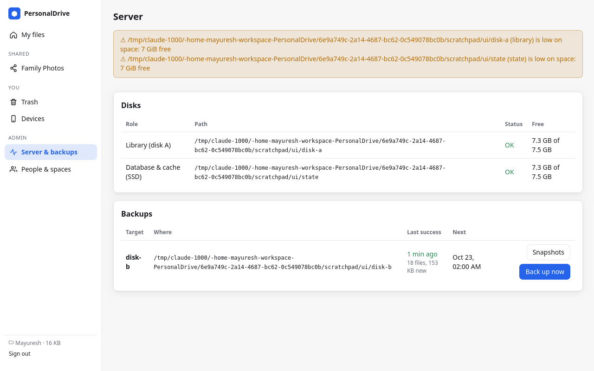
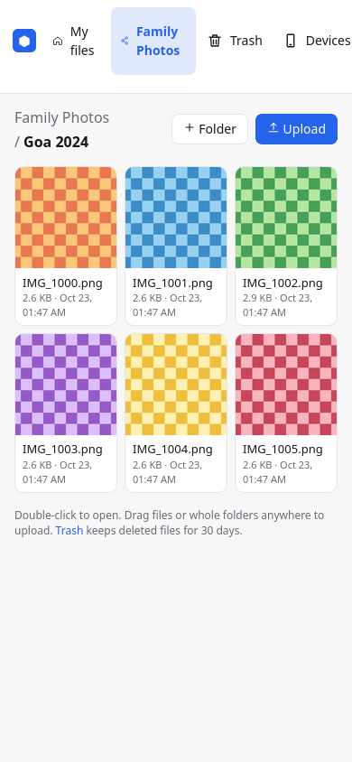

# web_app

The browser app, built into the server binary and served at the server's own
address (e.g. `https://home.local:8443`). Built with React + Vite on top of
`@pdrive/client`.



- **Files.** Your library and shared spaces: thumbnails, previews of photos and
  videos (arrow keys to browse), drag-and-drop of files *or whole folders*,
  rename, delete to trash, download. It updates live when other devices change
  things.
- **Uploads.** Resumable, hashed in the browser (WebAssembly SHA-256), skipped
  instantly when the server already has the file.
- **Trash.** Restore deleted items and earlier versions of edited files.
- **Devices.** A pairing QR code for phones and laptops, and signing out of lost
  devices.
- **Admin.** Disk and backup health, "back up now", snapshots, people, quotas and
  shared-space permissions.

| Server & backups | Phone |
| --- | --- |
|  |  |

## Develop

```bash
pnpm install
pnpm --filter @pdrive/client build
PDRIVE_URL=https://127.0.0.1:8443 pnpm --filter @pdrive/web dev   # proxies /api to a running server
```

Ship it inside the server with `make -C server build-full`. Plain `make build`
embeds a placeholder page instead.

## Security notes

- The server sends a strict CSP: same-origin scripts only, plus
  `wasm-unsafe-eval` for hashing.
- Files are previewed from the same origin, so file content is served with
  `Content-Security-Policy: sandbox`. An uploaded HTML or SVG file can't run
  scripts with your session.
- ``/`<video>` can't send headers, so media URLs carry the 15-minute access
  token. The server accepts that only on content and thumbnail endpoints, and sends
  `Referrer-Policy: no-referrer`.
